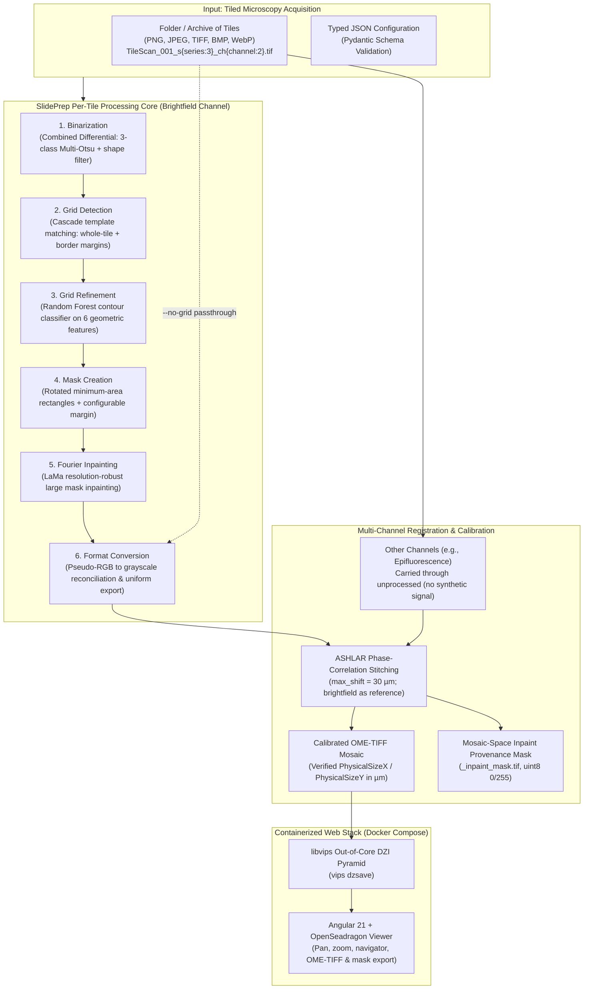

# SlidePrep

An open-source, modular microscopy preprocessing, artifact-removal, and whole-slide image (WSI) stitching pipeline developed by researchers at the **Universidade de Vigo** and the **Galicia Sur Health Research Institute (IIS Galicia Sur / SERGAS-UVIGO)** (Rodriguez-Conde, Campos & Fdez-Riverola, *SoftwareX* 2026). SlidePrep converts folders of overlapping microscopy tiles—particularly counting-chamber acquisitions containing high-contrast etched reference grids (reticles)—into physically calibrated, multi-channel **OME-TIFF** whole-slide mosaics and **Deep Zoom Image (DZI)** pyramids for browser-based inspection.

- **GitHub Repository:** [INOU-2025/SlidePrep](https://github.com/INOU-2025/SlidePrep) (Current release: [v1.0.4](https://github.com/INOU-2025/SlidePrep/releases/tag/v1.0.4))
- **Primary Publication:** Rodriguez-Conde I, Campos C, Fdez-Riverola F. *SlidePrep: artifact removal, reconstruction, and visualization of whole-slide images from tiled microscopy acquisitions.* SoftwareX 36 (2026) 103161. [DOI: 10.1016/j.softx.2026.103161](https://doi.org/10.1016/j.softx.2026.103161)
- **Companion Method Preprint:** Rodriguez-Conde I, Campos C, Fdez-Riverola F, Reboiro-Jato M, Pérez-Pérez M. *Automatic detection and removal of counting chamber grid artifacts from microscopy tile collections.* PACBB 2026 (Springer LNNS). [DOI: 10.5281/zenodo.21410751](https://doi.org/10.5281/zenodo.21410751)
- **Literature Review Clipping:** [SlidePrep: artifact removal, reconstruction, and visualization of whole-slide images from tiled microscopy acquisitions](../Clippings/SlidePrep%20-%20artifact%20removal%2C%20reconstruction%2C%20and%20visualization%20of%20whole-slide%20images%20from%20tiled%20microscopy%20acquisitions.md)
- **License:** MIT License (with full OSI-permissive dependency audit in `docs/LICENSE_AUDIT.md`)

---

## The Problem: Etched Reticles and Metadata-Free Tile Stitching

When laboratories digitize fluid or cytology suspensions in physical counting chambers (such as **Sedgwick-Rafter**, **Neubauer**, **Malassez**, **Bürker**, or **KOVA Glasstic** hemocytometers), hundreds of overlapping microscope tiles must be stitched into a unified whole-slide image. However, two major obstacles impede downstream automated morphometry and cell counting:

1. **Structural Occlusion by Etched Reticles:** Because the counting chamber's physical reference grid is etched directly at the focal plane, dark, high-contrast grid lines appear superimposed over cells and biological structures in almost every brightfield tile.
   - Standard **photometric/shading correction** tools (e.g., BaSiC, VISTAmap) correct uneven illumination, not structural occlusion.
   - **Fourier-domain notch filtering** assumes additive periodic noise, whereas an etched reticle physically blocks or attenuates transmitted light—suppressing its frequency peaks merely flattens the line without recovering occluded morphology.
   - **Intensity thresholding** fails because grid lines share intensity distributions with dark cellular borders, debris, or pigment deposits.
2. **Dependence on Vendor Stage Metadata:** Existing stitchers like **ASHLAR** typically rely on proprietary microscope stage coordinates, while **Fiji's Grid/Collection plugin** requires manual configuration. Furthermore, standard ASHLAR registration defaults (`--maximum-shift 15` µm) frequently discard valid adjacent tile edges when stage backlash exceeds 20–30 pixels.

**SlidePrep** bridges the gap between raw tile capture and quantitative bioimage analysis (`QuPath`, `Fiji`, `napari`, `CellProfiler`) by detecting and inpainting reticle artifacts per tile, reconstructing a global binary provenance mask of all synthesized pixels, and stitching calibrated OME-TIFF mosaics directly from filename conventions and declared overlap.

---

## System Architecture & Dual Execution Modes

SlidePrep shares a unified Python 3.12 processing core across two independent deployment interfaces: a batch **Command-Line Interface (CLI)** and a containerized **Web Application** orchestrated via Docker Compose.



---

## Core Algorithmic Pipeline

### 1. Six-Stage Per-Tile Reticle Removal
When operating in full preprocessing mode, each brightfield tile is processed independently (ensuring GPU memory scales with single-tile dimensions rather than total mosaic size):

| Step | Module (`src/steps/`) | Algorithmic Mechanism |
| :--- | :--- | :--- |
| **1. Binarization** | `binarization.py` | Applies the **Combined Differential** method: separates the three brightfield intensity populations (bright chamber floor, intermediate-intensity specimen/debris, darkest etched reticle) via **3-class multi-level Otsu thresholding**, then subtracts compact connected components (cells/pigments) to isolate elongated line candidates. Also exposes 6 alternative methods (`global`, `otsu`, `adaptive`, `multi_otsu`, `line_enhanced`, `morphological`). |
| **2. Grid Detection** | `grid_detection.py` | Runs a two-stage template-matching cascade using a short, blurred bar rendered at the expected line thickness (~21 px) and inclination (`angles`, e.g., $-2.0^\circ$). First searches the full tile for strong crossing lines, then searches border margins for clipped corner fragments. |
| **3. Grid Refinement** | `grid_refinement.py` | Evaluates weak border candidates using a trained **scikit-learn Random Forest classifier** (`models/rf_detection_classifier.joblib`) over 6 geometric contour features (`aspect_ratio`, `long_side_angle`, `corner_proximity`, `area`, `length`, `orientation_mismatch`), retaining at most one line per orientation. |
| **4. Mask Creation** | `mask_creation.py` | Rasterizes surviving detections using **rotated minimum-area rectangles** (following actual line inclination rather than axis-aligned boxes). Widens masks to `target_thickness` (default `22` px) so the inpainting network receives clean surrounding context, growing whole-tile lines symmetrically to tile edges and border fragments outward toward the margin. |
| **5. Inpainting** | `inpainting.py` | Reconstructs occluded pixels using **LaMa** (*Resolution-robust Large Mask Inpainting with Fourier Convolutions*, Suvorov et al., WACV 2022 via `simple-lama-inpainting`), pulling unmasked raw pixels directly from the shared pipeline context. |
| **6. Image Conversion** | `img_conversion.py` | Reconciles channel conventions (collapsing 3-channel pseudo-RGB required by LaMa back to single-channel grayscale expected by ASHLAR) and writes uniform tile formats across all channels. |

> [!TIP]
> **Passthrough Mode (`--no-grid`):** For clean microscopy tile acquisitions that do not contain counting-chamber grids, passing `--no-grid` (or toggling off *"Clean grid lines"* in the web wizard) bypasses Steps 1–5 and runs only format normalization and calibrated ASHLAR stitching.

### 2. Asymmetric Multi-Channel Handling & Provenance Masking
- **Zero Synthetic Fluorescence:** In multi-channel acquisitions (e.g., brightfield + epifluorescence), the reticle spans the entire field in transmitted light but only darkens emitting objects in fluorescence. SlidePrep removes and inpaints the grid **exclusively in the configured brightfield channel** (`ch00`), carrying fluorescence channels through completely unaltered so that no false fluorophore intensity is ever hallucinated.
- **Brightfield-Guided Registration:** Because epifluorescence backgrounds lack structural signal for phase correlation, ASHLAR computes tile registration transformations on the reconstructed brightfield channel and applies the exact same spatial coordinates across all fluorescence channels.
- **Mosaic-Level Inpainting Provenance Mask (`<mosaic_base>_inpaint_mask.tif`):** SlidePrep projects every per-tile binary mask into global mosaic space using ASHLAR's final tile offsets (combining overlaps via logical `OR`). Downstream analysis pipelines in **QuPath**, **Fiji**, or **CellProfiler** can load this `uint8` mask (`255` = reconstructed, `0` = observed) to exclude inpainted pixels from quantitative densitometry or fluorescence intensity measurements.

### 3. Calibrated OME-TIFF Assembly (`StitchingStep`)
- **Stage Shift Tolerance (`max_shift = 30` µm):** Standard ASHLAR defaults to a 15 µm maximum shift (~24 px at 0.630 µm/px), which prematurely rejects valid tile pairs when motorized stage offsets reach ~31 px. SlidePrep increases the default to `30` µm based on empirical edge-retention sweeps.
- **Mandatory Micrometric Calibration:** `stitching.pixel_size` (µm/pixel) has no default value—Pydantic schema validation fails loudly if omitted, preventing silent pixel-vs-micrometer miscalibration. After stitching, SlidePrep audits the embedded OME-XML metadata and injects `PhysicalSizeX` and `PhysicalSizeY` if absent, ensuring immediate physical scale recognition in [QuPath](../Clippings/From%20Samples%20to%20Knowledge%202025%20-%20QuPath%20Training%20Course.md) and Fiji.

---

## Performance Benchmarks

Evaluated on a 1,372-tile Sedgwick-Rafter counting-chamber dataset of *Mytilus galloprovincialis* veliger larvae ($14 \times 49$ raster = 686 positions $\times$ 2 channels, $1344 \times 1024$ px per tile, 10% overlap, 0.630 µm/pixel, Leica AF 6000 10×/0.40 dry objective) on an Intel Core i7-11700F (64 GB RAM) with an NVIDIA RTX 3050 (8 GB VRAM):

| Metric / Stage | CPU Backend (Median) | GPU Backend (RTX 3050, CUDA 12.8) | Notes / Speedup |
| :--- | :---: | :---: | :--- |
| **Per-Tile Reticle Removal (686 brightfield tiles)** | 4,698 s (~78.3 min) | **839 s (~14.0 min)** | **5.6× GPU speedup** |
| **LaMa Inpainting Share of Per-Tile Time** | 98.4% | 86.2% | Constant VRAM scaling (processes 1 tile at a time) |
| **Global ASHLAR Stitching (1,372 tiles)** | 227 s | 227 s | Produces $17,640 \times 44,447$ px mosaic ($11.1 \times 28.0$ mm, 766 MB) |
| **Global Inpaint Mask Composition** | 110 s | 110 s | Full-mosaic `uint8` provenance mask |
| **Grid Artifact Detection Accuracy** | — | **Tile $F_1 = 0.9934$**<br>**Pixel $F_1 = 0.9642$** | Evaluated across 686 annotated tiles vs. $F_1 = 0.2974$ for Otsu baseline |

---

## Installation, CLI, and Web Deployment

### 1. Conda & Python Environment Setup
Requires **Python 3.12** and a **Java Development Kit (JDK)** (required by ASHLAR via Bio-Formats: `brew install openjdk` on macOS or `sudo apt install default-jdk` on Ubuntu).

```bash
# macOS / Linux CPU environment
conda env create -f environment.yml -n slideprep
conda activate slideprep
pip install --no-deps simple-lama-inpainting==0.1.2

# Linux with NVIDIA GPU (CUDA 12.8, PyTorch 2.7.1+cu128)
conda env create -f environment-cuda.yml -n slideprep
conda activate slideprep
pip install --no-deps simple-lama-inpainting==0.1.2
```

### 2. Command-Line Batch Execution
Tiles must follow the configured naming pattern (default `TileScan_001_s{series:3}_ch{channel:2}.tif` in column-major order):

```bash
# Run on bundled 3x3 Sedgwick-Rafter sample dataset
python main.py sample_data/config.json \
    --input  sample_data/tiles \
    --output sample_data/output

# Full production run (grid removal + OME-TIFF stitching)
python main.py config/production.json

# Passthrough mode (clean tiles: format normalization + stitching only)
python main.py config/production.json --no-grid
```

### 3. Programmatic Python API
```python
import cv2
from src.core.pipeline_service import PipelineService

gray = cv2.imread("tile.png", cv2.IMREAD_GRAYSCALE)

# Keeps LaMa and Random Forest weights loaded in memory across tiles
service = PipelineService("config/production.json")
result = service.run(gray, image_path="tile.png")
reconstructed_tile = result.image
```

### 4. Containerized Web Stack & REST API
The Docker Compose stack launches four services: **FastAPI** (`port 8000`), **Celery** (switched to `--pool=solo` under GPU override so a single CUDA context is safely used), **Redis** (`port 6379`), and **nginx** (`port 80`) serving the **Angular 21 + OpenSeadragon** frontend:

```bash
# CPU deployment
docker compose up --build

# GPU-accelerated deployment (requires nvidia-container-toolkit)
docker compose -f docker-compose.yml -f docker-compose.gpu.yml up --build
```

Downstream automated counting or morphometry pipelines can also drive SlidePrep headlessly via its **REST API**:
- `POST /jobs` — Upload tile archive and override per-job grid/pixel parameters; returns `job_id`.
- `GET /jobs/{job_id}` — Poll phase progress (`detecting grid` $\to$ `removing grid` $\to$ `stitching` $\to$ `finalizing` $\to$ `completing`) and DZI pyramid URL.
- `GET /jobs/{job_id}/export` — Stream the physically calibrated OME-TIFF mosaic.
- `GET /jobs/{job_id}/export/mask` — Stream the composed `<mosaic_base>_inpaint_mask.tif` provenance mask.
- `DELETE /jobs/{job_id}` — Delete uploaded tiles and output artifacts from `data/`.

---

## Retargeting to New Chamber Geometries

To adapt SlidePrep from Sedgwick-Rafter chambers to **Neubauer**, **Malassez**, **Bürker**, or eyepiece reticles:
1. **Export Contour Features:** Set `"debug": { "save_aggregated_data": true, "saved_artifact_type": "data", "result_file_name": "rf-data.csv" }` in the JSON config and run on 5–10 representative tiles.
2. **Label Contours:** Add an `is_detection` (`TRUE`/`FALSE`) column to the exported 6-feature CSV (`aspect_ratio`, `long_side_angle`, `corner_proximity`, `area`, `length`, `orientation_mismatch`).
3. **Retrain Classifier:** Execute 5-fold cross-validated Random Forest grid search:
   ```bash
   python training/train_rf_detection_classifier.py --infile rf-data.csv --balanced
   ```

---

## Vault Connections

- [SlidePrep: artifact removal, reconstruction, and visualization of whole-slide images from tiled microscopy acquisitions](../Clippings/SlidePrep%20-%20artifact%20removal%2C%20reconstruction%2C%20and%20visualization%20of%20whole-slide%20images%20from%20tiled%20microscopy%20acquisitions.md) — Companion *SoftwareX* (2026) article digest and comparison against prior counting-chamber grid removal methods.
- [Digital Pathology Software](digital-pathology-software.md) — Comparative catalog of open-source WSI viewers, stitchers, and analysis platforms.
- [OpenFlexure Microscope](openflexure-microscope.md) & [HistoCAM](histocam.md) — Complementary open-source hardware/software platforms for converting optical microscope acquisitions into stitched multi-resolution digital slides.
- [Cytario](cytario.md) — Cloud-native OME-TIFF and OME-Zarr viewer capable of streaming large stitched mosaics.
- [From Samples to Knowledge 2025: QuPath Training Course](../Clippings/From%20Samples%20to%20Knowledge%202025%20-%20QuPath%20Training%20Course.md) — Downstream quantitative image analysis in QuPath utilizing SlidePrep's calibrated OME-TIFF and inpaint mask outputs.

<!-- tolaria:related:start -->

## See also

* [Cytario](cytario.md)
* [Digital Pathology](digital-pathology.md)
* [From Samples to Knowledge 2025: QuPath Training Course](../Clippings/From%20Samples%20to%20Knowledge%202025%20-%20QuPath%20Training%20Course.md)
* [HistoCAM](histocam.md)
* [Image Analysis](image-analysis.md)
* [Microscopy](../laboratory-management/microscopy.md)
* [OpenFlexure Microscope](openflexure-microscope.md)
* [SlidePrep: artifact removal, reconstruction, and visualization of whole-slide images from tiled microscopy acquisitions](../Clippings/SlidePrep%20-%20artifact%20removal%2C%20reconstruction%2C%20and%20visualization%20of%20whole-slide%20images%20from%20tiled%20microscopy%20acquisitions.md)

<!-- tolaria:related:end -->
